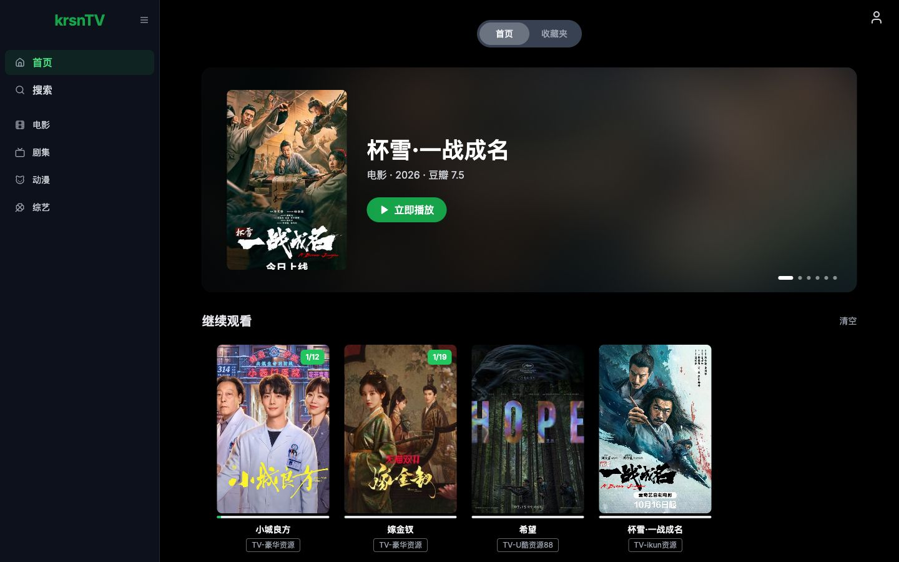
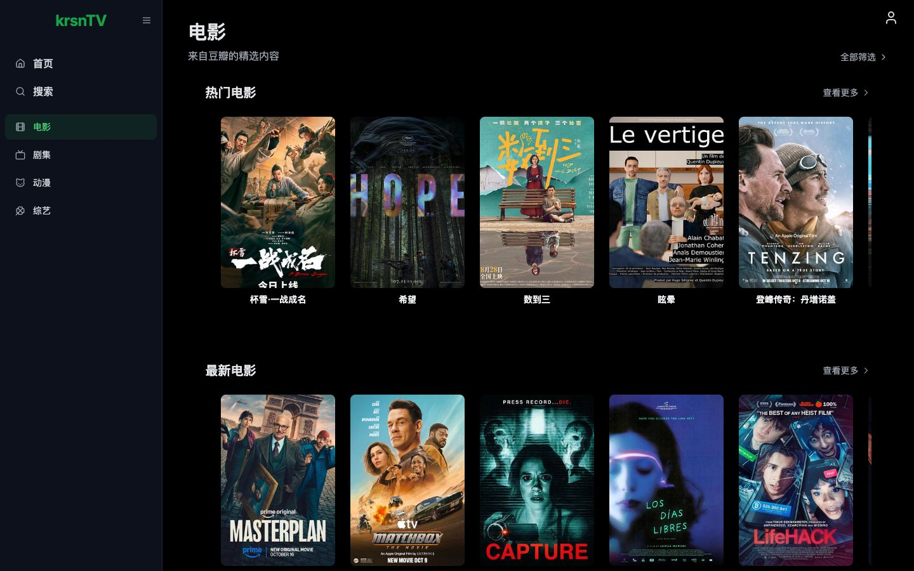
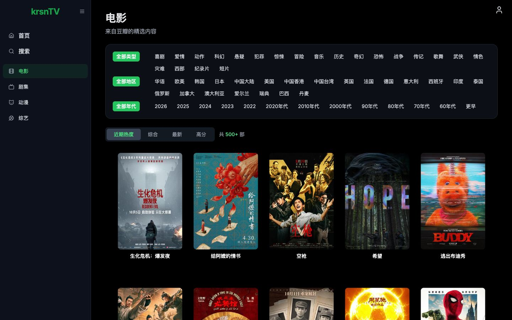

# krsnTV

<div align="center">
  
</div>

> 🎬 **krsnTV** is a cross-platform video aggregation player. It lists movies, TV series, anime, and variety shows from Douban, and plays them from many free video sources. It is built with **Next.js 14**, **Tailwind&nbsp;CSS**, and **TypeScript**, and is a fork of [MoonTV](https://github.com/Stardm0/MoonTV).

<div align="center">


</div>

---

## ✨ Features

- 🧭 **Browse by Channel**: each Channel (movies, TV series, anime, variety shows) opens on a page of Shelves. Each Shelf leads to a full Listing with filter rows (type, region, year, platform), four sort orders (popular, overall, newest, top rated), the result count, and numbered pages.
- 🔗 **Shareable Listings**: filters, sort, and the page number are in the URL, so reload, Back, and shared links show the same results.
- 🔍 **Multi-source search**: searches every video source at the same time and streams the results.
- ▶️ **Fast playback**: playback starts at the first matching source. Sources that keep failing are skipped for 30 minutes.
- 📺 **Player**: HLS.js and ArtPlayer, with AirPlay on Safari and iOS, and an experimental filter for ad segments.
- ❤️ **Favorites and Continue Watching**: stored in the browser, or in Redis or Upstash to sync across devices.
- 🛡️ **Reliable Douban data**: retries, caching, and an automatic switch to a Douban CDN mirror when the server cannot reach Douban.
- 🌙 **Dark interface**: responsive layout with a sidebar on desktop and bottom navigation on mobile.
- 📱 **PWA**: install it to the desktop or home screen.

<details>
  <summary>Screenshots</summary>
  
  
  
</details>

## 🗺 Contents

- [Tech Stack](#tech-stack)
- [Deployment](#deployment)
  - [Vercel](#vercel)
  - [Netlify](#netlify)
  - [Docker](#docker)
  - [Redis and Upstash Storage](#redis-and-upstash-storage)
- [Environment Variables](#environment-variables)
- [Configuration](#configuration)
- [Admin Configuration](#admin-configuration)
- [Android TV](#android-tv)
- [Security and Privacy](#security-and-privacy)
- [License](#license)
- [Acknowledgements](#acknowledgements)

## Tech Stack

| Category       | Main dependencies                                                                                     |
| -------------- | ----------------------------------------------------------------------------------------------------- |
| Framework      | [Next.js 14](https://nextjs.org/) · App Router                                                        |
| UI and styling | [Tailwind&nbsp;CSS 3](https://tailwindcss.com/)                                                       |
| Language       | TypeScript 4                                                                                          |
| Player         | [ArtPlayer](https://github.com/zhw2590582/ArtPlayer) · [HLS.js](https://github.com/video-dev/hls.js/) |
| Code quality   | ESLint · Prettier · Jest                                                                              |

## Deployment

You can deploy to Vercel, Netlify, or Docker. Watch history and favorites are stored in the browser (`localstorage`) by default, or in Redis or Upstash.

|               | Docker | Vercel | Netlify |
| :-----------: | :----: | :----: | :-----: |
| Native Redis  |   ✅   |        |         |
| Upstash Redis |   ☑️   |   ✅   |   ✅    |

✅ tested · ☑️ supported in theory, not tested

### Vercel

1. **Fork** this repository to your GitHub account.
2. Log in to [Vercel](https://vercel.com/), click **Add New → Project**, and select your fork.
3. Set the `PASSWORD` environment variable to require a login (recommended; see [Security and Privacy](#security-and-privacy)).
4. Deploy with the default settings.
5. To change the video sources, edit `config.json` in your fork. Every push to `main` builds and deploys again.

> **Note:** Douban sometimes throttles requests from Vercel for a few minutes. The app then loads the Douban lists in the viewer's browser from a Douban CDN mirror. To skip the server for Douban data completely, set `NEXT_PUBLIC_DOUBAN_PROXY_TYPE` to one of the browser options (see [Environment Variables](#environment-variables)).

### Netlify

1. **Fork** this repository to your GitHub account.
2. Log in to [Netlify](https://www.netlify.com/), click **Add New project → Importing an existing project**, authorize GitHub, and select your fork.
3. Set the `PASSWORD` environment variable to require a login (recommended).
4. Deploy with the default settings. Every push to `main` builds and deploys again.

### Docker

See [LunaTV](https://github.com/MoonTechLab/LunaTV) for the Docker image and instructions.

### Redis and Upstash Storage

Use a database to sync watch history and favorites across devices, and to manage users and settings in the admin page.

1. Finish a standard deployment and confirm that the site opens.
2. Create a Redis database at [Upstash](https://upstash.com/) and copy its **HTTPS ENDPOINT** and **TOKEN**.
3. Add these environment variables to your Vercel or Netlify project:
   - `UPSTASH_URL` and `UPSTASH_TOKEN`: the endpoint and token from step 2
   - `NEXT_PUBLIC_STORAGE_TYPE`: `upstash`
   - `USERNAME` and `PASSWORD`: the site owner account (required in this mode)
4. Redeploy.

For a native Redis server (Docker), set `NEXT_PUBLIC_STORAGE_TYPE` to `redis` and `REDIS_URL` to its connection URL.

## Environment Variables

| Variable                              | Description                                                                                                                                                   | Default                                                            |
| ------------------------------------- | ------------------------------------------------------------------------------------------------------------------------------------------------------------- | ------------------------------------------------------------------ |
| `PASSWORD`                            | Login password. With `localstorage`, the site is open to everyone when it is not set. With Redis or Upstash, it is the site owner's password and is required. | (empty)                                                            |
| `USERNAME`                            | Site owner account for Redis or Upstash                                                                                                                       | (empty)                                                            |
| `NEXT_PUBLIC_SITE_NAME`               | Site name                                                                                                                                                     | `krsnTV`                                                           |
| `ANNOUNCEMENT`                        | Notice shown once on the home page                                                                                                                            | A disclaimer (in Chinese) that the site only provides video search |
| `NEXT_PUBLIC_STORAGE_TYPE`            | Storage for watch history and favorites: `localstorage`, `redis`, or `upstash`                                                                                | `localstorage`                                                     |
| `REDIS_URL`                           | Redis connection URL                                                                                                                                          | (empty)                                                            |
| `UPSTASH_URL`                         | Upstash Redis HTTPS endpoint                                                                                                                                  | (empty)                                                            |
| `UPSTASH_TOKEN`                       | Upstash Redis token                                                                                                                                           | (empty)                                                            |
| `NEXT_PUBLIC_ENABLE_REGISTER`         | Allow new users to register (Redis or Upstash only): `true` or `false`                                                                                        | `false`                                                            |
| `NEXT_PUBLIC_SEARCH_MAX_PAGE`         | Maximum pages the search fetches from each source (1–50)                                                                                                      | `5`                                                                |
| `NEXT_PUBLIC_DOUBAN_PROXY_TYPE`       | How Douban data is loaded (see below)                                                                                                                         | `direct`                                                           |
| `NEXT_PUBLIC_DOUBAN_PROXY`            | URL prefix for a custom Douban data proxy                                                                                                                     | (empty)                                                            |
| `NEXT_PUBLIC_DOUBAN_IMAGE_PROXY_TYPE` | How Douban posters are loaded (see below)                                                                                                                     | `direct`                                                           |
| `NEXT_PUBLIC_DOUBAN_IMAGE_PROXY`      | URL prefix for a custom Douban image proxy                                                                                                                    | (empty)                                                            |
| `NEXT_PUBLIC_DISABLE_YELLOW_FILTER`   | Turn off the adult content filter: `true` or `false`                                                                                                          | `false`                                                            |

Users can also change the Douban data and image sources in the user menu. The menu setting overrides these defaults for that browser.

`NEXT_PUBLIC_DOUBAN_PROXY_TYPE`:

- `direct`: the server requests Douban. If that fails, the browser switches to the `cmliussss-cdn-tencent` mirror automatically.
- `cors-proxy-zwei`: the browser uses a CORS proxy run by [Zwei](https://github.com/bestzwei).
- `cmliussss-cdn-tencent`: the browser uses a Douban CDN mirror run by [CMLiussss](https://github.com/cmliu) on Tencent Cloud CDN.
- `cmliussss-cdn-ali`: the same mirror on Alibaba Cloud CDN.
- `custom`: the proxy in `NEXT_PUBLIC_DOUBAN_PROXY`.

`NEXT_PUBLIC_DOUBAN_IMAGE_PROXY_TYPE`:

- `direct`: the browser loads posters from Douban's default image domain.
- `server`: the server proxies poster requests. Douban sometimes throttles servers, so prefer `direct` or `img3`.
- `img3`: the browser uses Douban's official premium CDN (Alibaba Cloud).
- `cmliussss-cdn-tencent` / `cmliussss-cdn-ali`: the browser uses the CMLiussss Douban CDN mirror.
- `custom`: the proxy in `NEXT_PUBLIC_DOUBAN_IMAGE_PROXY`.

## Configuration

With `localstorage`, all settings are in `config.json` in the project root. With Redis or Upstash, change them in the admin page.

```json
{
  "cache_time": 7200,
  "api_site": {
    "dyttzy": {
      "api": "http://caiji.dyttzyapi.com/api.php/provide/vod",
      "name": "DYTT Resources",
      "detail": "http://caiji.dyttzyapi.com"
    }
  },
  "custom_category": [
    {
      "name": "Chinese-language",
      "type": "movie",
      "query": "华语"
    }
  ]
}
```

- `cache_time`: cache time for Douban and search responses, in seconds.
- `api_site`: the video sources. Each source uses the Apple CMS V10 API format.
  - The key (`dyttzy` above): unique ID; use lowercase letters and digits.
  - `api`: root URL of the source's `vod` JSON API.
  - `name`: display name.
  - `detail`: (optional) root URL of the source's web detail pages, for sources whose API does not return episode details.
- `custom_category`: extra categories in the `自定义` (Custom) Channel. `type` + `query` must be unique.
  - `name`: display name (optional; defaults to `query`)
  - `type`: `movie` or `tv`
  - `query`: the Douban tag in Chinese, from the tables below, or any keyword (for example, `哈利波特` for Harry Potter), which works like a Douban search

<details>
  <summary>Known Douban tags</summary>

`type: "movie"`:

| Category            | `query`    |
| ------------------- | ---------- |
| Hot                 | `热门`     |
| Latest              | `最新`     |
| Classics            | `经典`     |
| Top rated on Douban | `豆瓣高分` |
| Hidden gems         | `冷门佳片` |
| Chinese-language    | `华语`     |
| Western             | `欧美`     |
| Korean              | `韩国`     |
| Japanese            | `日本`     |
| Action              | `动作`     |
| Comedy              | `喜剧`     |
| Romance             | `爱情`     |
| Science fiction     | `科幻`     |
| Mystery             | `悬疑`     |
| Horror              | `恐怖`     |
| Feel-good           | `治愈`     |

`type: "tv"`:

| Category           | `query`    |
| ------------------ | ---------- |
| Hot                | `热门`     |
| US series          | `美剧`     |
| UK series          | `英剧`     |
| Korean series      | `韩剧`     |
| Japanese series    | `日剧`     |
| Chinese series     | `国产剧`   |
| Hong Kong series   | `港剧`     |
| Japanese animation | `日本动画` |
| Variety shows      | `综艺`     |
| Documentaries      | `纪录片`   |

</details>

On Vercel and Netlify, the build copies `config.json` into the app, so push the change to trigger a new build. In Docker, the service reads `config.json` at startup, so a restart is enough.

## Admin Configuration

**This feature needs Redis or Upstash storage.**

`USERNAME` and `PASSWORD` define the site owner. The site owner can make other users admins. The site owner and admins open `/admin` to change sources, categories, users, and site settings at runtime.

## Android TV

You can use krsnTV as the backend for [OrionTV](https://github.com/zimplexing/OrionTV) on Android TV. For now, OrionTV keeps its own favorites and watch history; they do not sync with the web app.

## Security and Privacy

**Set `PASSWORD`, and keep public registration off.** Without `PASSWORD`, anyone who finds the site can use it.

- **Misuse**: an open instance can be abused and use up your server resources.
- **Copyright**: a public video search service can receive copyright complaints.
- **Privacy**: a password keeps your watch history private.

Use the site for yourself only. Do not share the link publicly, and follow the laws where you live.

This project is for learning and personal use. Do not run it as a commercial or public service. Users are responsible for any legal issues caused by sharing their instance; the developers are not.

## License

[MIT](LICENSE) © 2025 MoonTV & Contributors

## Acknowledgements

- [MoonTV](https://github.com/Stardm0/MoonTV) — the project this fork is based on.
- [ts-nextjs-tailwind-starter](https://github.com/theodorusclarence/ts-nextjs-tailwind-starter) — the original project template.
- [LibreTV](https://github.com/LibreSpark/LibreTV) — the inspiration for MoonTV.
- [ArtPlayer](https://github.com/zhw2590582/ArtPlayer) — web video player.
- [HLS.js](https://github.com/video-dev/hls.js) — HLS playback in the browser.
- [Zwei](https://github.com/bestzwei) — CORS proxy for Douban data.
- [CMLiussss](https://github.com/cmliu) — Douban CDN mirror.
- All sites that provide free video APIs.
